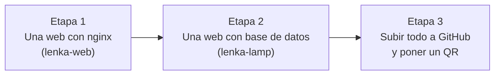

# 🧭 Guía para principiantes

**Objetivo:** crear tus propias imágenes de Docker, subirlas a Docker Hub y verlas funcionando en Internet con tu dominio y candado (HTTPS).

!!! info "Cómo usar esta guía"
    Cada paso dice **dónde** se escribe (💻 tu PC o 🖥️ el servidor), **qué** escribir y **qué debes ver**. Si ves lo que dice la casilla ✅, sigue al siguiente paso.

---

## 🎒 Antes de empezar

- [ ] Cuenta en **GitHub** (guarda el código y la explicación)
- [ ] Cuenta en **Docker Hub** (guarda las imágenes)
- [ ] Un **servidor con Docker** (aquí se llama *Sauron*)
- [ ] Un **dominio** apuntando al servidor (aquí `lenkakyjovska.online`)
- [ ] **Nginx Proxy Manager** (NPM) funcionando: pone el candado HTTPS
- [ ] En tu PC: **git** y **gh** (GitHub CLI) instalados

## 🗺️ El plan en tres etapas



!!! tip "La idea en una frase"
    **Dockerfile** (receta) → `docker build` (cocinar) → **imagen** (plato congelado) → `docker push` (guardarlo en la tienda) → `docker compose up` (servirlo) → **contenedor** (plato servido).

---

## 🥇 Etapa 1 · Tu primera imagen: una web con nginx

### Paso 1 · Crear la carpeta y la página
🖥️ **Servidor**
```bash
mkdir -p ~/stacks/lenka-web && cd ~/stacks/lenka-web
nano index.html
```
Escribe una página HTML sencilla y guarda.

### Paso 2 · Escribir el Dockerfile (la receta)
🖥️ **Servidor**, en la misma carpeta (`nano Dockerfile`):
```dockerfile
FROM nginx:alpine
COPY index.html /usr/share/nginx/html/
EXPOSE 80
```
`FROM` = punto de partida (se descarga solo de Docker Hub). `COPY` = mete tu página. `EXPOSE` = avisa del puerto.

### Paso 3 · Construir la imagen
🖥️ **Servidor**
```bash
docker build -t lkyj004/lenka-web:1.0 .
```
✅ Debe terminar con `naming to docker.io/lkyj004/lenka-web:1.0`.

### Paso 4 · Subirla a Docker Hub
🖥️ **Servidor**
```bash
docker login -u lkyj004
docker push lkyj004/lenka-web:1.0
```
La contraseña se escribe a mano y no se ve.
✅ Debe salir `digest: sha256:...` y la imagen aparece en <https://hub.docker.com>.

### Paso 5 · Ponerla a funcionar
🖥️ **Servidor** (`nano docker-compose.yml`):
```yaml
services:
  web:
    image: lkyj004/lenka-web:1.0
    container_name: lenka-web
    restart: unless-stopped
    networks:
      - proxy
networks:
  proxy:
    external: true
```
```bash
docker compose up -d
docker ps
```
✅ En `docker ps` aparece `lenka-web` como `Up (healthy)`.

### Paso 6 · Darle dominio y candado
En **NPM** → *Proxy Hosts* → *Add*:

| Campo | Valor |
|---|---|
| Domain Names | `lenkakyjovska.online` |
| Forward Hostname | `lenka-web` |
| Forward Port | `80` |
| SSL | Let's Encrypt + Force SSL |

✅ Al abrir <https://lenkakyjovska.online> se ve tu página con candado 🔒.

!!! warning "Si cambias la página más adelante"
    Un contenedor sigue usando la imagen con la que nació. Hay que **construir otra versión, subirla, cambiar el número en el compose y repetir `docker compose up -d`**. Y recargar el navegador con `Ctrl+F5`.

---

## 🥈 Etapa 2 · Una web con base de datos (LAMP)

**LAMP** = **L**inux + **A**pache + **M**ariaDB + **P**HP, todo dentro de **una sola imagen**.

| Paso | Qué se hace | Dónde |
|---|---|---|
| 1 | Crear la carpeta `~/stacks/lenka-lamp` | 🖥️ |
| 2 | Escribir 4 archivos: `Dockerfile`, `entrypoint.sh`, `init.sql`, `index.php` | 🖥️ |
| 3 | Construir: `docker build -t lkyj004/lenka-lamp:1.0 .` | 🖥️ |
| 4 | Subir: `docker push lkyj004/lenka-lamp:1.0` | 🖥️ |
| 5 | Crear el archivo `.env` con la contraseña de la base de datos (nunca dentro de la imagen) | 🖥️ |
| 6 | Desplegar: `docker compose up -d` | 🖥️ |
| 7 | En NPM: `lamp.lenkakyjovska.online` → `lenka-lamp` puerto `80` + SSL | 🌐 |

✅ La página muestra las versiones del software y una **tabla con 8 filas** que sale de la base de datos.

👉 Todos los comandos y la explicación están en el [Tutorial LAMP paso a paso](tutorial-lamp.md).

---

## 🥉 Etapa 3 · Subir todo a GitHub y poner un QR

### Paso 1 · Guardar el proyecto con git
💻 **Tu PC** (terminal, dentro de la carpeta del proyecto)
```bash
git init -b main
git add .
git commit -m "Mi primera imagen de Docker"
```
`git` es el **cuaderno con historial** de tu PC; **GitHub** es la **nube** donde subes una copia.

### Paso 2 · Crear el repositorio en GitHub y subirlo
💻 **Tu PC**
```bash
gh repo create web-lenka --public --source=. --push
```
✅ Sale `Created repository` y el enlace `https://github.com/lkyjovska/web-lenka`.

!!! note "Si la subida se corta"
    Si aparece `Connection was reset`, es un corte de red puntual. El repositorio ya está creado: repite `git push -u origin main`.

### Paso 3 · Añadir el QR a la imagen
En el `Dockerfile` se añade al final (antes de `EXPOSE`):
```dockerfile
ARG GITHUB_URL=https://github.com/lkyjovska/web-lenka
RUN apk add --no-cache libqrencode-tools \
 && qrencode -s 8 -m 2 -o /usr/share/nginx/html/qr.png "${GITHUB_URL}"
```
Y en `index.html` se muestra con ``.

### Paso 4 · Construir, subir y desplegar la versión 1.2
🖥️ **Servidor**
```bash
docker build -t lkyj004/lenka-web:1.2 .
docker push lkyj004/lenka-web:1.2
sed -i 's/lenka-web:1.0/lenka-web:1.2/' docker-compose.yml
docker compose up -d
```
✅ En la web aparece el QR. Al escanearlo con el móvil se abre tu repositorio en GitHub.

### Paso 5 · Cerrar la sesión de Docker Hub
🖥️ **Servidor**
```bash
docker logout
```
Es como cerrar sesión en Netflix en un ordenador que no es tuyo. Las webs siguen funcionando igual.

---

## 🛟 Si algo no sale

| Qué ves | Qué hacer |
|---|---|
| La web no cambia tras actualizar | `Ctrl+F5` y comprobar con `docker ps` que el contenedor usa la versión nueva |
| `denied` o `requested access` al hacer `push` | Falta iniciar sesión: `docker login -u tuusuario` |
| `Connection was reset` en `git push` | Corte de red: repetir `git push -u origin main` |
| La web no abre por el dominio | Revisar en NPM que el host apunta al **nombre del contenedor** y que ambos están en la red `proxy` |
| Aviso de certificado | En NPM, pestaña SSL: pedir de nuevo el certificado Let's Encrypt |

## 📖 Mini glosario

| Palabra | En una frase |
|---|---|
| **Dockerfile** | La receta de la imagen |
| **Imagen** | La receta ya cocinada: solo se lee, se puede repetir |
| **Contenedor** | La imagen funcionando |
| **Docker Hub** | La tienda donde se guardan las imágenes |
| **Compose** | Un archivo que describe cómo arrancar el contenedor |
| **Volumen** | Un sitio donde los datos no se pierden al borrar el contenedor |
| **Proxy (NPM)** | El recepcionista: recibe las visitas, pone el candado y las manda al contenedor |
| **git / GitHub** | El cuaderno con historial / la nube donde se publica |
| **QR** | Una dirección web dibujada en cuadraditos |
