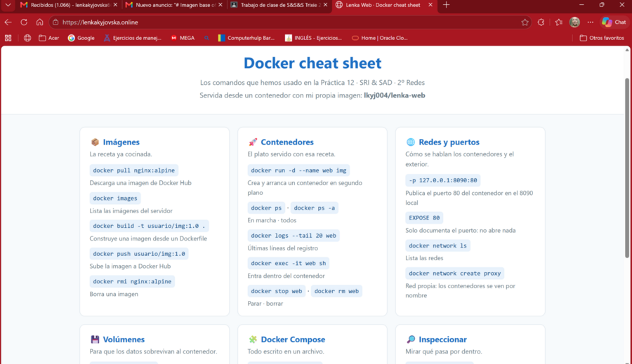
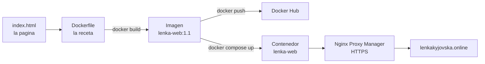

# 📦 La imagen `lenka-web`

Antes del LAMP hicimos una imagen más sencilla: **una página web con nginx**. Es el mejor ejemplo para entender el ciclo completo de Docker: **escribir → construir → subir → desplegar**.



## 🗺️ El recorrido



## 1. Cuenta en Docker Hub e imagen base

**Docker Hub** es como una tienda de aplicaciones, pero de imágenes: de ahí se **descargan** las que ya existen y ahí se **suben** las nuestras. Se crea una cuenta gratuita en <https://hub.docker.com>; el nombre de usuario (`lkyj004`) forma parte del nombre de la imagen: `lkyj004/lenka-web`.

Nuestro Dockerfile parte de una imagen que ya existe (`nginx:alpine`). **No hace falta descargarla a mano**: la línea `FROM` la baja de Docker Hub al hacer el `build`. Aun así, se puede hacer con:

```bash
docker pull nginx:alpine
docker images
```

!!! tip "No se modifica la imagen descargada"
    La `nginx:alpine` original queda intacta. Nuestro Dockerfile le **añade capas** y el resultado es **otra imagen distinta**: `lkyj004/lenka-web`.

## 2. El Dockerfile, línea a línea

```dockerfile
FROM nginx:alpine
LABEL maintainer="Lenka Kyjovska" description="Web de la practica 12"
ENV TZ=Europe/Madrid
WORKDIR /usr/share/nginx/html
COPY index.html .
RUN echo "imagen construida el $(date)" > build-info.txt
EXPOSE 80
HEALTHCHECK --interval=30s --timeout=5s CMD wget -q -O /dev/null http://localhost/ || exit 1
```

| Instrucción | Qué hace |
|---|---|
| `FROM nginx:alpine` | Imagen base: un Linux muy ligero con el servidor web nginx ya instalado |
| `LABEL` | Autor y descripción |
| `ENV TZ=Europe/Madrid` | La zona horaria del contenedor |
| `WORKDIR` | La carpeta que nginx publica como web |
| `COPY index.html .` | Copia **nuestra página** a la imagen |
| `RUN echo ...` | Ejecuta un comando al construir: escribe la fecha de construcción |
| `EXPOSE 80` | Documenta el puerto (no abre nada) |
| `HEALTHCHECK` | Cada 30 s comprueba que la web responde |

`FROM`, `WORKDIR`, `COPY` y `RUN` crean **capas** (por eso `docker build` muestra «4/4» pasos). Las demás solo añaden información.

## 3. Construir y subir la imagen

```bash
docker build -t lkyj004/lenka-web:1.0 .
docker login -u lkyj004
docker push lkyj004/lenka-web:1.0
```

`-t` pone nombre y versión (`usuario/nombre:etiqueta`) y el punto final indica que el Dockerfile está en la carpeta actual. La contraseña de `docker login` se escribe a mano y no se muestra.

## 4. Desplegarla

```yaml
services:
  web:
    image: lkyj004/lenka-web:1.1
    container_name: lenka-web
    restart: unless-stopped
    networks:
      - proxy
networks:
  proxy:
    external: true
```

```bash
docker compose up -d
```

En Nginx Proxy Manager, el host `lenkakyjovska.online` apunta a `http://lenka-web:80` con certificado de Let's Encrypt. NPM encuentra el contenedor **por su nombre** porque están en la misma red (`proxy`).

## 5. Actualizar a la versión 1.1

Cuando cambia la página hay que construir una imagen nueva, subirla y **recrear** el contenedor.

!!! warning "Ojo"
    Un contenedor en marcha **sigue usando la imagen con la que nació**. Construir y subir la 1.1 no basta: hay que cambiar el compose y volver a hacer `up`.

```bash
cp index.html index.html.bak                      # copia de seguridad
docker build -t lkyj004/lenka-web:1.1 .           # imagen nueva
docker push lkyj004/lenka-web:1.1                 # subirla
sed -i 's#lenka-web:1.0#lenka-web:1.1#' docker-compose.yml
docker compose up -d                              # recrear el contenedor
docker inspect -f '{{.Name}} usa {{.Config.Image}}' lenka-web
```

Se recarga la página con `Ctrl+F5` para no ver la copia en caché.

## `EXPOSE` frente a `-p`

`EXPOSE` solo **documenta** el puerto. Para abrirlo de verdad hay que **publicarlo** con `-p`. Detrás de NPM no hace falta publicar nada: llega por la red `proxy`.
