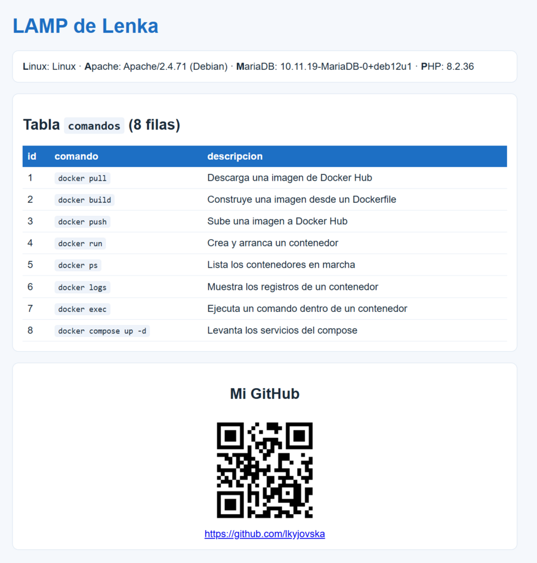
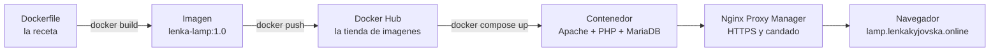
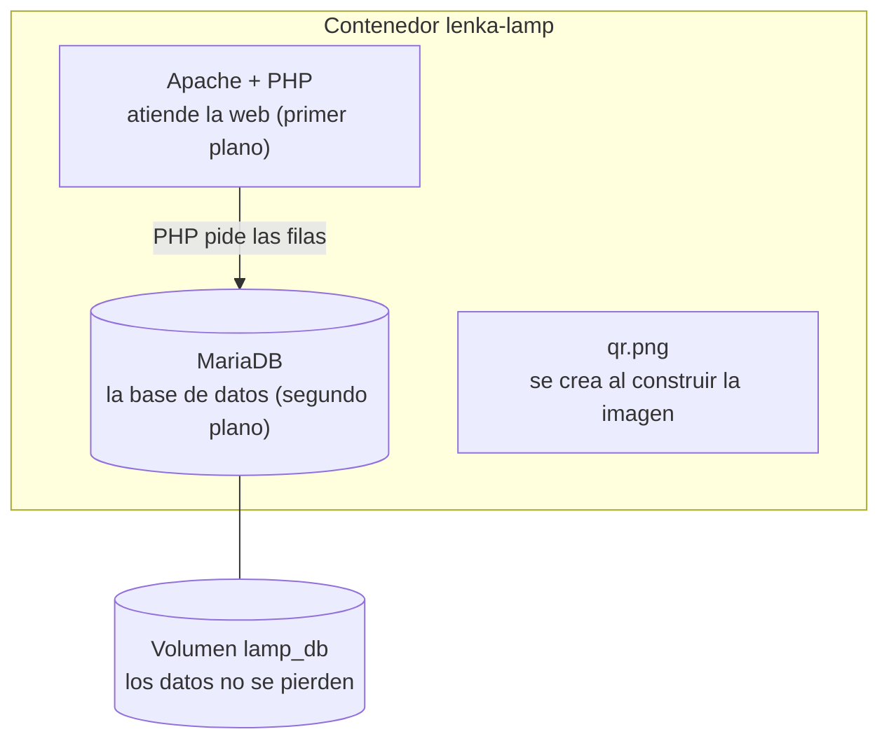

# 🐳 Mi primera imagen LAMP en Docker

> Una sola imagen de Docker con **Linux + Apache + MariaDB + PHP**, una **base de datos que funciona en segundo plano**, una **página PHP que muestra todas las filas de una tabla** y un **código QR** que lleva a este GitHub. Publicada en Docker Hub y desplegada con **HTTPS** detrás de Nginx Proxy Manager.

Práctica 12 de *Seguridad y Servicios* (2º Redes, IES Politécnico Jesús Marín) · Autora: **Lenka Kyjovská**

🌍 **Web en directo:** https://lamp.lenkakyjovska.online
📦 **Imagen en Docker Hub:** https://hub.docker.com/r/lkyj004/lenka-lamp

---

## 🧒 Si no sabes nada de Docker: la explicación de la pizzería

Imagina que quieres vender pizzas:

| En la pizzería | En Docker | Qué significa |
|---|---|---|
| 📝 La **receta** | **Dockerfile** | Un papel que dice, paso a paso, cómo se hace el plato |
| 🍕 La pizza **ya hecha y congelada** | **Imagen** | El resultado de seguir la receta. Se puede guardar y repetir |
| 🍽️ La pizza **servida en la mesa** | **Contenedor** | La imagen funcionando de verdad |
| 📖 La **carta** del restaurante | **Docker Hub** | Donde se guardan las imágenes para que cualquiera las pida |
| 🧊 El **congelador** | **Volumen** | Donde se guardan los datos para que no se pierdan |
| 🛎️ El **recepcionista** | **Proxy (NPM)** | Recibe a los clientes y los manda a la mesa correcta |

Y **LAMP** son los cuatro ingredientes de nuestra pizza:

| Letra | Ingrediente | Para qué sirve |
|---|---|---|
| **L** | **L**inux (Debian) | El sistema operativo de la imagen |
| **A** | **A**pache | El servidor web: recibe a los visitantes |
| **M** | **M**ariaDB | La base de datos: guarda la tabla con las filas |
| **P** | **P**HP | El camarero: pide las filas a la base de datos y las pone en la página |

---

## 🗺️ El recorrido completo

## 🔍 Qué hay dentro del contenedor

Lo importante: **MariaDB funciona en segundo plano** (por detrás) mientras Apache atiende las visitas. Los datos se guardan en un **volumen**, así que si el contenedor se borra y se vuelve a crear, la tabla sigue ahí.

---

## 🔎 Qué encontrarás aquí

- 🚀 [Tutorial LAMP paso a paso](tutorial-lamp.md): cómo se ha creado la imagen, con todos los comandos.
- 📦 [La imagen lenka-web](imagen-lenka-web.md): la primera imagen que hicimos con un Dockerfile.
- 🐳 [Docker cheatsheet](cheatsheet.md): la chuleta de comandos.
